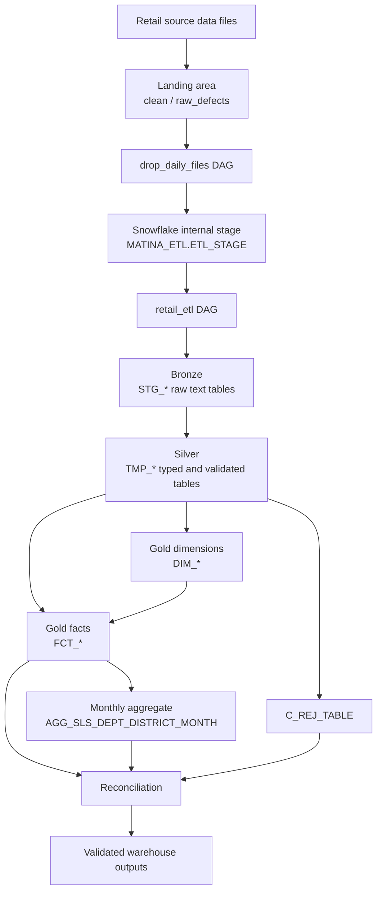
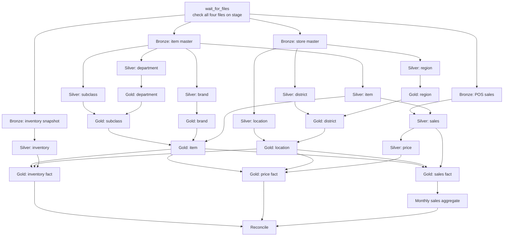

# Northline Retail Data Warehouse

An end-to-end retail data warehousing project built with **Apache Airflow, Snowflake, SQL, Python and Docker Compose**. The repository demonstrates file ingestion, batch orchestration, a Bronze–Silver–Gold (medallion) data pipeline, dimensional modelling, data-quality quarantine, slowly changing dimensions, positional facts, aggregate reporting and reconciliation.

> **Implementation note:** This README documents the workflows and SQL that are present in this repository. The architecture notes also describe a broader multi-source design (Xstore, NCR and OMS). The executable pipeline currently included here is the narrower RMS/POS training implementation using four daily files: item master, store master, POS sales and inventory snapshot. The broader design notes are retained under `architecture/` as design documentation and should not be mistaken for additional running DAGs.

---

## Table of contents

1. [Project overview](#1-project-overview)
2. [Objectives and scope](#2-objectives-and-scope)
3. [Technology stack](#3-technology-stack)
4. [Architecture](#4-architecture)
5. [Data warehouse model](#5-data-warehouse-model)
6. [ETL workflows and DAGs](#6-etl-workflows-and-dags)
7. [Data quality and reconciliation](#7-data-quality-and-reconciliation)
8. [Repository structure](#8-repository-structure)
9. [Prerequisites](#9-prerequisites)
10. [Configuration](#10-configuration)
11. [Snowflake setup](#11-snowflake-setup)
12. [Running the project](#12-running-the-project)
13. [Testing](#13-testing)
14. [Results and evidence](#14-results-and-evidence)
15. [Reruns, backfills and recovery](#15-reruns-backfills-and-recovery)
16. [Design decisions](#16-design-decisions)
17. [Known limitations](#17-known-limitations)
18. [Security and operational notes](#18-security-and-operational-notes)
19. [Further documentation](#19-further-documentation)

---

## 1. Project overview

Northline is a retail data warehouse project that takes operational retail data files and turns them into structured, validated, analytics-ready warehouse tables in Snowflake.

The project is organised around the medallion architecture:

- **Bronze:** preserve the source data as it arrives, without business transformations.
- **Silver:** clean, validate, type and conform the data. Invalid rows are written to a rejection table with a reason code.
- **Gold:** populate the dimensional warehouse model and its fact tables, maintaining historical versions where required.

Apache Airflow coordinates the workflow. It waits for data to arrive, executes SQL in Snowflake, manages dependencies between tasks, supports retries and backfills, and runs final reconciliation checks.

The repository also includes a separate ingestion exercise (`load_files_to_snowflake`) that demonstrates how to wait for a `.COMPLETE` marker and dynamically load every CSV in a local directory into its own Snowflake table without transforming the file contents.

### Main outcomes

- Automated file-arrival detection and batch loading.
- Snowflake internal-stage ingestion using `PUT` and `COPY INTO`.
- Bronze, Silver and Gold data layers.
- Typed and validated Silver data with row-level rejection.
- Retail product and store hierarchies.
- Transactional sales and positional inventory/price facts.
- SCD Type 1 and Type 2 dimension handling.
- A monthly sales aggregate for reporting.
- Reconciliation checks that fail the ETL run when totals do not tie.
- Airflow DAG tests and SQL-based validation evidence.

---

## 2. Objectives and scope

### 2.1 Assignment 2.1 — dimensional data model

Create a Snowflake retail dimensional model consisting of dimensions, facts and an aggregate table. The model defines the grain of each fact, surrogate keys, relationships and the SCD behaviour of dimensions.

The original 2.1 model uses names such as `DIM_CATEGORY`, `DIM_SUBCATEGORY` and `DIM_CITY`. In the later ETL implementation, these are represented using the retail source terminology `DIM_DEPT`, `DIM_SUBCLASS` and `DIM_DISTRICT`.

### 2.2 Assignment 2.2 — load local CSV files into Snowflake

Build an Airflow DAG that:

1. Waits for a `.COMPLETE` marker in a local folder.
2. Discovers the CSV files in that folder.
3. Dynamically creates one load task per file.
4. Creates a Snowflake table with text columns.
5. Uploads each file to a Snowflake internal stage and runs `COPY INTO`.
6. Reports load results and archives the files after successful loads.

This workflow deliberately performs **no business transformation**. All source columns are loaded as `VARCHAR`.

Target: `SNOWFLAKE_LEARNING_DB.MATINA_ORCHESTRATION`.

### 2.3 Assignment 2.3 — retail medallion ETL

Build a second Airflow workflow that loads daily retail data through Bronze, Silver and Gold in Snowflake.

The executable daily pipeline uses these four files:

| Daily file | Bronze table | Silver outputs |
|---|---|---|
| `item_master_YYYYMMDD.csv` | `STG_ITEM_MASTER` | `TMP_DEPT`, `TMP_SUBCLASS`, `TMP_BRAND`, `TMP_ITEM` |
| `store_master_YYYYMMDD.csv` | `STG_STORE_MASTER` | `TMP_REGION`, `TMP_DISTRICT`, `TMP_LOCN` |
| `pos_sales_YYYYMMDD.csv` | `STG_POS_SALES` | `TMP_SALES`, then `TMP_PRICE` |
| `inventory_snapshot_YYYYMMDD.csv` | `STG_INVENTORY_SNAPSHOT` | `TMP_INVENTORY` |

The Gold layer contains dimensions, facts and a monthly aggregate. The ETL schema is `SNOWFLAKE_LEARNING_DB.MATINA_ETL`.

---

## 3. Technology stack

| Technology | Role in the project |
|---|---|
| **Apache Airflow 3.3.2** | DAG scheduling, task orchestration, sensors, retries, dynamic task mapping, backfills and monitoring |
| **Snowflake** | Cloud data warehouse, internal stages, file formats, Bronze/Silver/Gold tables and SQL execution |
| **SQL** | DDL, ingestion, transformations, dimensional loads, fact loads and reconciliation |
| **Python** | Airflow DAG definitions, helper functions, file preparation and tests |
| **Docker Compose** | Local Airflow development environment |
| **PostgreSQL** | Airflow metadata database |
| **Redis** | Celery message broker |
| **pytest** | Automated tests |
| **Git** | Source control |

The Snowflake provider is required by the Airflow DAGs. The current Compose configuration supports installing extra Python packages through `_PIP_ADDITIONAL_REQUIREMENTS` in `.env`; this is convenient for a learning environment, not the recommended production image-building approach.

---

## 4. Architecture

### 4.1 High-level architecture



Airflow runs the orchestration logic. Snowflake stores the data and performs the SQL transformations. Files are uploaded to a Snowflake internal stage before Bronze loading.

### 4.2 Layer responsibilities

| Layer | Purpose | Objects | Data handling |
|---|---|---|---|
| **Bronze** | Preserve landed source records | `STG_*` | Source columns remain text; batch date, source filename and ingestion timestamp provide lineage |
| **Silver** | Clean and conform the source data | `TMP_*`, `C_REJ_TABLE`, `C_LOAD_LOG` | Convert types, validate business rules, resolve hierarchy relationships and quarantine invalid rows |
| **Gold** | Provide the dimensional warehouse for analytics | `DIM_*`, `FCT_*`, `AGG_*` | Surrogate keys, SCD handling, fact loading and pre-aggregated reporting data |

The executable ETL setup places these objects in one Snowflake schema, `MATINA_ETL`; the object prefixes identify their logical layer.

### 4.3 Data flow and task dependencies



Independent Bronze and Silver branches run in parallel where their inputs do not depend on each other. The DAG explicitly enforces dependencies where a child needs a parent or a fact needs a dimension.

### 4.4 Snowflake schemas

| Database | Schema | Purpose |
|---|---|---|
| `SNOWFLAKE_LEARNING_DB` | `MATINA_ORCHESTRATION` | Assignment 2.2 generic CSV-to-table loader |
| `SNOWFLAKE_LEARNING_DB` | `MATINA_ETL` | Assignment 2.3 Bronze, Silver and Gold warehouse |
| `SNOWFLAKE_LEARNING_DB` | `MATINA_ASSIGNMENT` | Original Assignment 2.1 model, where retained separately |

The Assignment 2.2 loader and Assignment 2.3 ETL are separate workflows and use different target schemas and configuration.

---

## 5. Data warehouse model

The dimensional model is documented in `model/model_notes.md`, `model/create_tables.sql` and `model/er_diagram.png`.

### 5.1 Dimensions

| Dimension | Business entity | SCD approach |
|---|---|---|
| `DIM_DEPT` | Department (originally `DIM_CATEGORY`) | SCD1 |
| `DIM_SUBCLASS` | Subclass (originally `DIM_SUBCATEGORY`) | SCD1 |
| `DIM_BRAND` | Brand | SCD1 |
| `DIM_ITEM` | Retail item | SCD2 on item name, subclass and brand |
| `DIM_REGION` | Region | SCD1 |
| `DIM_DISTRICT` | District (originally `DIM_CITY`) | SCD1 |
| `DIM_LOCN` | Store/location | SCD2 on location name and district |
| `DIM_CUSTOMER` | Customer | SCD1; seeded Unknown row in the implemented ETL |
| `DIM_YEAR` | Calendar year | Seeded |
| `DIM_MONTH` | Calendar month | Seeded |
| `DIM_DAY` | Calendar day | Seeded |

All dimensions use surrogate keys (`*_KY`) and standard warehouse metadata such as effective dates, current-row flags, record timestamps, source-system code and batch ID.

**SCD1** overwrites a changed attribute when previous values are not required for historical reporting.

**SCD2** preserves versions of a record using effective date ranges and a current-row flag. This is used for items and locations because changes to their classification or hierarchy can affect how historical sales should roll up.

For example, when a store moves to another district, historical sales should remain associated with the district that applied at the time of sale. The old location version is closed and a new version is inserted.

### 5.2 Facts and aggregate

| Table | Type | Grain |
|---|---|---|
| `FCT_SALES` | Transaction fact | One transaction line for one item, at one location, on one business day |
| `FCT_PRICE` | Positional fact | The price for one item/location over an effective period |
| `FCT_INVENTORY` | Positional fact | The stock position for one item/location over an effective period |
| `AGG_SLS_DEPT_DISTRICT_MONTH` | Aggregate | Sales totals by department, district and month |

**Transaction facts** represent business events. A sales line is loaded at its transaction grain.

**Positional facts** represent a value that remains valid for a period, such as a price or inventory position. They use `EFF_FROM_DT` and `EFF_TO_DT` to represent the period of validity.

The monthly aggregate is derived from `FCT_SALES`. Sales quantity and sales/discount amounts can be summed at this grain. Price is not additive, and inventory is a point-in-time balance, so neither is rolled into the sales aggregate.

### 5.3 Surrogate keys and relationships

Gold facts reference dimension surrogate keys rather than source business IDs. The load SQL resolves the business IDs from Silver to the appropriate Gold dimension version.

Snowflake primary-key, unique and foreign-key declarations document the model, but standard Snowflake table constraints are generally not enforced. The ETL and reconciliation logic therefore have responsibility for maintaining key integrity.

---

## 6. ETL workflows and DAGs

There are three DAGs in `dags/`.

### 6.1 `load_files_to_snowflake` — generic CSV loader (Assignment 2.2)

**File:** `dags/load_files_to_snowflake.py`  
**Helper:** `dags/loader_utils.py`  
**Target:** `SNOWFLAKE_LEARNING_DB.MATINA_ORCHESTRATION`

The DAG waits for `.COMPLETE` in the configured local source folder. Once the signal exists, it discovers CSV files and maps one `load_file` task to each file.

Task flow:

```text
wait_for_complete_signal
        |
     list_files
        |
 load_file (mapped once per CSV)
        |
      report
        |
  archive_files

load_file failure --> alert_on_failure
```

Each file load:

1. Determines the target table from the configured filename-to-table mapping.
2. Creates or replaces a Snowflake stage and target table as required by the helper.
3. Removes an existing staged copy, uploads the local file using `PUT`, and loads it using `COPY INTO`.
4. Checks the loaded row count against the local CSV row count.
5. Returns a result dictionary for reporting.

The four sample files and documented results are:

| File | Target table | Rows loaded |
|---|---|---:|
| `sales.csv` | `STG_SALES` | 500 |
| `inventory.csv` | `STG_INVENTORY` | 500 |
| `item.csv` | `STG_ITEM` | 738 |
| `location.csv` | `STG_LOCATION` | 40 |

All columns are loaded as text (`VARCHAR`); this assignment does not perform type conversion or business transformation.

**Airflow features demonstrated**

- `FileSensor` in `reschedule` mode, with a 30-second poke interval and a six-hour timeout.
- XCom for passing discovered file paths and task result dictionaries.
- Dynamic Task Mapping using `load_file.expand(path=files)`.
- Airflow Connections: `snowflake_default` and `northline_fs`.
- `SnowflakeHook` for Snowflake SQL and file operations.
- Airflow Variables for folder, schema, stage, file mapping and expected filenames.
- DAG Params for run-specific source folder and archive behaviour.
- Trigger rules: `all_done` for reporting and `one_failed` for the failure alert.
- Two retries per task, a daily 06:00 UTC schedule and `max_active_runs=1`.

The alert task currently writes an error to the Airflow task log. It is an extension point for a real email or messaging integration, not a configured external notification.

### 6.2 `drop_daily_files` — simulated source delivery (Assignment 2.3)

**File:** `dags/drop_daily_files.py`  
**Schedule:** Manual trigger only.

This DAG simulates the upstream system delivering a daily batch. It reads the requested business date and dataset (`clean` or `raw_defects`), then uploads the four corresponding files to the Snowflake internal stage:

```text
@SNOWFLAKE_LEARNING_DB.MATINA_ETL.ETL_STAGE/<YYYYMMDD>/
```

It uses `PUT ... OVERWRITE=TRUE`, making the stage upload repeatable, and lists the staged files in the task log.

Parameters:

- `day`: business date in `YYYYMMDD` format; default `20260916`.
- `dataset`: `clean` or `raw_defects`; default `clean`.

### 6.3 `retail_etl` — Bronze to Silver to Gold (Assignment 2.3)

**File:** `dags/retail_etl.py`  
**Schedule:** Daily (`@daily`)  
**Target:** `SNOWFLAKE_LEARNING_DB.MATINA_ETL`

The DAG waits for all four expected files for the logical business date to appear in the Snowflake stage. It then executes the SQL files in `include/sql/`.

#### Bronze loading

Bronze tasks load:

- `STG_ITEM_MASTER`
- `STG_STORE_MASTER`
- `STG_POS_SALES`
- `STG_INVENTORY_SNAPSHOT`

Source attributes are retained as text. The tables also record the batch date, source filename and ingestion timestamp to support traceability.

#### Silver transformations

Silver tasks build the following tables:

- Product hierarchy: `TMP_DEPT`, `TMP_SUBCLASS`, `TMP_BRAND`, `TMP_ITEM`
- Store hierarchy: `TMP_REGION`, `TMP_DISTRICT`, `TMP_LOCN`
- Transactional data: `TMP_SALES`
- Positional data: `TMP_INVENTORY`
- Price data: `TMP_PRICE`

The SQL converts source values into typed warehouse values, validates required fields and business rules, and writes rejected rows to `C_REJ_TABLE` with the source table, gate, reason code, source filename and row payload.

The sales task depends on `silver_item` because every sales item must resolve to the Silver item set. The price task is derived from valid Silver sales lines and therefore runs after `silver_sales`.

#### Gold dimensions

The dimension tasks load parent dimensions before child dimensions:

- Root dimensions: department, brand and region.
- Subclass waits for department.
- District waits for region.
- Item waits for subclass and brand.
- Location waits for district.

`DIM_YEAR`, `DIM_MONTH`, `DIM_DAY` and `DIM_CUSTOMER` are seeded tables in this implementation; they do not have daily dimension tasks in this DAG.

#### Gold facts and aggregate

The DAG loads:

- `FCT_SALES` from `TMP_SALES`.
- `FCT_INVENTORY` from `TMP_INVENTORY`.
- `FCT_PRICE` from `TMP_PRICE`.
- `AGG_SLS_DEPT_DISTRICT_MONTH` from `FCT_SALES`.

Facts wait for the relevant Gold dimensions so that business keys can be resolved to dimension surrogate keys. The aggregate is rebuilt for the affected month rather than incremented.

#### Reconciliation

The `reconcile` task runs last. It executes `include/sql/reconcile/reconcile.sql`, compares expected and actual row counts and monetary totals, prints each check, and fails the Airflow task if any comparison does not match.

The DAG uses `max_active_runs=1` because the SCD2 and positional-fact processing assumes business dates are processed in order. Automatic catchup is disabled; historical days are loaded deliberately using backfills.

---

## 7. Data quality and reconciliation

### 7.1 Rejected-row handling

The Silver layer does not silently replace missing or invalid hierarchy values with invented defaults. Rows that cannot be trusted are written to `C_REJ_TABLE`.

The table records:

- `BATCH_DT`: batch/business date.
- `SRC_TABLE`: source or Silver table where the row originated.
- `GATE`: validation stage.
- `REASON_CODE`: why the row was rejected.
- `SRC_FILE_NM`: source filename.
- `ROW_PAYLOAD`: rejected row as a `VARIANT`.
- `REJ_TS`: rejection timestamp.

This makes data-quality problems inspectable and supports reconciliation between input, accepted and rejected records.

### 7.2 Implemented validation examples

The current Silver SQL includes checks such as:

| Data area | Validation | Example rejection reason |
|---|---|---|
| Item master | Required item identifier and complete hierarchy | `NULL_ITEM_ID`, `NULL_HIERARCHY` |
| Store master | Required store identifier and valid region/district hierarchy | `NULL_HIERARCHY` |
| Sales | Required item ID, convertible dates and numbers, valid sale quantity sign, known item | `NULL_ITEM_ID`, `BAD_DATE_OR_NUMBER`, `NEGATIVE_QTY_ON_SALE`, `UNKNOWN_ITEM` |
| Inventory | Required item ID, valid snapshot date and convertible stock quantity | `NULL_ITEM_ID`, `BAD_SNAPSHOT_DT`, `BAD_NUMBER` |

Rules are evaluated in a defined order so a row receives the first applicable rejection reason. Negative quantities on return transactions are valid and are not rejected merely because they are negative.

### 7.3 Reconciliation

The reconciliation SQL includes checks for:

- Bronze sales row count = Silver sales row count + rejected sales rows.
- Bronze sales net amount = Silver sales net amount + rejected sales amount.
- Silver sales row count = Gold sales fact rows + Gold-stage rejected rows.
- Silver sales value = Gold sales value + rejected sales value.
- Bronze inventory rows = Silver inventory rows + rejected inventory rows.
- Silver inventory rows and value = valid Gold positional inventory rows + rejected rows.
- Gold monthly sales aggregate totals = the corresponding monthly sales fact totals.
- Price coverage and Silver-to-Gold price reconciliation.

A mismatch is treated as a pipeline failure rather than a successful load with an unnoticed discrepancy.

### 7.4 Documented baseline results

For business date `2026-09-16`, the project notes record these Silver results:

**Product and store hierarchy**

| Table | Accepted rows |
|---|---:|
| `TMP_DEPT` | 13 |
| `TMP_SUBCLASS` | 83 |
| `TMP_BRAND` | 11 |
| `TMP_ITEM` | 728 |
| `TMP_REGION` | 7 |
| `TMP_DISTRICT` | 13 |
| `TMP_LOCN` | 39 |
| `C_REJ_TABLE` | 10 |

Item reconciliation: 738 Bronze rows = 728 Silver rows + 9 rejected rows + 1 exact duplicate removed.

The nine rejected item rows consist of eight items without a department (`NULL_HIERARCHY`) and one row without an item ID (`NULL_ITEM_ID`). Item `10000004` occurs twice with identical values; one copy is retained by `QUALIFY ROW_NUMBER() = 1`.

Store reconciliation: 40 Bronze rows = 39 Silver rows + one rejected row. Store `503` (`DC West - Reno`) is a distribution centre with no region and is rejected rather than assigned a made-up region.

**Sales**

| Measure | Rows |
|---|---:|
| Bronze `STG_POS_SALES` | 1,471 |
| Silver `TMP_SALES` | 1,376 |
| Rejected: `NULL_ITEM_ID` | 82 |
| Rejected: `UNKNOWN_ITEM` | 13 |

The 13 unknown-item sales relate to items that were rejected from the item hierarchy. Returns are retained, including valid negative quantities and amounts.

**Inventory**

| Measure | Rows |
|---|---:|
| Bronze `STG_INVENTORY_SNAPSHOT` | 12,485 |
| Silver `TMP_INVENTORY` | 12,484 |
| Rejected: `BAD_SNAPSHOT_DT` | 1 |

The rejected row has a future placeholder snapshot date (`2099-01-04`). A valid date conversion alone would not detect it; the business rule that a snapshot cannot be later than the batch day catches it. Warehouse stock rows are retained.

**Gold dimensions**

| Dimension | Silver rows | Gold rows | Current rows |
|---|---:|---:|---:|
| `DIM_DEPT` | 13 | 13 | 13 |
| `DIM_SUBCLASS` | 83 | 83 | 83 |
| `DIM_BRAND` | 11 | 11 | 11 |
| `DIM_ITEM` | 728 | 728 | 728 |
| `DIM_REGION` | 7 | 7 | 7 |
| `DIM_DISTRICT` | 13 | 13 | 13 |
| `DIM_LOCN` | 39 | 39 | 39 |

The documented Gold run found zero orphan items. Re-running the same business date produced identical dimension counts.

---

## 8. Repository structure

```text
matina-northline-retail-dwh/
├── architecture/
│   ├── architecture_diagram.png
│   ├── architecture_notes.md
│   └── layer_inventory.csv
├── config/
│   └── airflow.cfg
├── dags/
│   ├── basic_dag_run_assignment.py
│   ├── drop_daily_files.py
│   ├── loader_utils.py
│   ├── load_files_to_snowflake.py
│   └── retail_etl.py
├── data/
│   ├── incoming/
│   │   ├── sales.csv
│   │   ├── inventory.csv
│   │   ├── item.csv
│   │   ├── location.csv
│   │   └── archive/
│   └── landing/
│       ├── clean/
│       ├── raw_defects/
│       └── landing_summary.json
├── include/
│   ├── airflow_variables.json
│   └── sql/
│       ├── bronze/
│       ├── silver/
│       ├── gold/
│       ├── reconcile/
│       └── ddl/
├── model/
│   ├── create_tables.sql
│   ├── er_diagram.png
│   ├── er_diagram_code.dbml
│   └── model_notes.md
├── output_screenshots/
├── scripts/
│   └── prepare_daily_files.py
├── tests/
│   ├── test_load_files_dag.py
│   └── test_retail_etl_dag.py
├── .gitignore
├── docker-compose.yaml
└── README.md
```

Other runtime directories, including `logs/`, are generated by Airflow and are not source code. Local environment files and Snowflake connection exports must not be committed.

### Important directories

| Path | Contents |
|---|---|
| `dags/` | Airflow DAG definitions and Python loading helpers |
| `include/sql/bronze/` | SQL that loads source files into Bronze tables |
| `include/sql/silver/` | SQL transformations, typing and validation |
| `include/sql/gold/` | Dimension, fact and aggregate load SQL |
| `include/sql/ddl/` | One-time schema setup and migration scripts |
| `include/sql/reconcile/` | End-of-pipeline reconciliation |
| `data/landing/clean/` | Prepared daily input files for the normal load |
| `data/landing/raw_defects/` | Deliberately defective input set for data-quality testing |
| `data/incoming/` | Local folder used by the Assignment 2.2 loader |
| `architecture/` | Architecture notes, layer inventory and diagram |
| `model/` | Dimensional model DDL, ERD and model notes |
| `tests/` | DAG and helper tests |
| `output_screenshots/` | Assignment evidence and result screenshots |

---

## 9. Prerequisites

Before running the project, have:

- Docker Desktop (or Docker Engine with the Compose plugin).
- A Snowflake account with permission to create databases/schemas, stages, file formats and tables, and to run the required SQL.
- A Snowflake role and warehouse that can access `SNOWFLAKE_LEARNING_DB`.
- Airflow-compatible Snowflake provider packages installed in the Airflow environment.
- Python 3 for running local preparation scripts and tests.
- Git, if cloning the repository.

The supplied Compose file uses the Airflow image configured in the file (default `apache/airflow:3.3.2`) with CeleryExecutor, PostgreSQL and Redis. The Compose configuration is intended for local development and learning, not production deployment.

---

## 10. Configuration

### 10.1 Environment file

Create a local `.env` file from your own environment settings. Do not copy credentials into the DAG source or commit `.env`.

The Compose configuration reads environment variables for the Airflow image, user ID, project directory, Fernet key, API JWT secret and additional Python requirements. The Snowflake provider installation is configured through `_PIP_ADDITIONAL_REQUIREMENTS` for this learning setup.

For example, the provider package must be available in the Airflow environment. Use a pinned, compatible provider version for a repeatable environment. For production, build a custom Airflow image instead of installing packages at every container startup.

### 10.2 Airflow Connections

Create these connections in the Airflow UI.

#### `snowflake_default`

Used by all DAGs that interact with Snowflake.

Configure it with the account, username, password or supported authentication method, warehouse, database, schema and role appropriate to your Snowflake environment. The exact values depend on your account and must be supplied locally.

For the ETL workflow, the intended database/schema is `SNOWFLAKE_LEARNING_DB.MATINA_ETL`.

#### `northline_fs`

Used by the Assignment 2.2 `FileSensor` to check the local source folder.

Configure the Airflow filesystem connection so that its base path is the folder containing the `.COMPLETE` marker and CSV files. The sensor's `filepath` is resolved relative to this connection.

The source folder must be mounted into the Airflow containers. The Compose file mounts the repository's `data/` directory at `/opt/airflow/data`.

### 10.3 Airflow Variables

Import `include/airflow_variables.json` through **Airflow UI → Admin → Variables** for the generic CSV loader.

| Variable | Purpose |
|---|---|
| `northline_source_folder` | Local directory containing CSV files and `.COMPLETE` |
| `northline_target_schema` | Target schema, normally `MATINA_ORCHESTRATION` |
| `northline_stage_name` | Snowflake stage name |
| `northline_file_table_map` | JSON mapping of source filenames to destination tables |
| `northline_expected_files` | Comma-separated list of files expected for the batch |

The included JSON maps:

- `sales.csv` → `STG_SALES`
- `inventory.csv` → `STG_INVENTORY`
- `item.csv` → `STG_ITEM`
- `location.csv` → `STG_LOCATION`

The `retail_etl` and `drop_daily_files` DAGs use their configured schema/stage constants in the DAG source and SQL scripts; the Assignment 2.2 variables do not configure those workflows.

### 10.4 Airflow DAG parameters

| DAG | Parameter | Meaning |
|---|---|---|
| `load_files_to_snowflake` | `source_folder` | Optional per-run override for the local source folder |
| `load_files_to_snowflake` | `archive_after_load` | Whether to move files and `.COMPLETE` into `archive/<batch>/` |
| `drop_daily_files` | `day` | Business date in `YYYYMMDD` format |
| `drop_daily_files` | `dataset` | `clean` or `raw_defects` |

---

## 11. Snowflake setup

Connect to Snowflake using the role intended for the ETL. Run the setup scripts in the order relevant to the assignment.

### 11.1 Assignment 2.1 model

The original dimensional model DDL is in:

```text
model/create_tables.sql
```

It creates the dimensions, facts and aggregate structure for the 2.1 model. Run it in the intended database/schema context.

### 11.2 Assignment 2.2 target schema

Create the generic loader schema:

```sql
CREATE SCHEMA IF NOT EXISTS
    SNOWFLAKE_LEARNING_DB.MATINA_ORCHESTRATION;
```

The loader creates/loads its stage and target tables through `dags/loader_utils.py`.

### 11.3 Assignment 2.3 ETL schema

Run:

```text
include/sql/ddl/setup_etl.sql
```

This is a **destructive setup script**: it drops and recreates the ETL tables. It creates `MATINA_ETL`, the `ETL_STAGE` internal stage, the `ETL_CSV` file format, Bronze tables, Silver tables, rejection and load-log tables, and the Gold dimensional model.

Do not rerun it against a populated warehouse unless you intend to reset those tables.

The price extension migration is:

```text
include/sql/ddl/add_price_silver.sql
```

It adds `UNIT_PRC` to `TMP_SALES` and creates `TMP_PRICE`. Run it when setting up the price-loading extension, if that change is not already present in the schema.

The naming migration is:

```text
include/sql/ddl/rename_gold_to_2_2.sql
```

It aligns the Gold dimension names with the ETL terminology (`DIM_DEPT`, `DIM_SUBCLASS`, `DIM_DISTRICT`). Run it only when the existing schema needs that migration; do not blindly rerun migrations against an already aligned schema.

### 11.4 Snowflake permissions

The Airflow Snowflake role must be able to use the warehouse, database and schema, create/use the required stage and file format, read/write the target tables, and execute the SQL statements used by the DAGs.

The project notes record an ownership issue where Gold tables were initially owned by `ACCOUNTADMIN`. The Airflow role could not write to those tables until ownership was transferred to `SNOWFLAKE_LEARNING_ROLE`. Ensure the role that runs Airflow has the necessary privileges and ownership/access before starting the pipeline.

---

## 12. Running the project

### 12.1 Start Airflow

From the repository root:

```bash
docker compose up -d
```

Check the containers:

```bash
docker compose ps
```

Open the Airflow UI:

```text
http://localhost:8080
```

Use the administrator credentials configured for your local Airflow environment.

If this is the first start, allow the initialization service to finish before using the UI. Check container logs if a service is unhealthy:

```bash
docker compose logs airflow-init
docker compose logs airflow-scheduler
docker compose logs airflow-apiserver
```

### 12.2 Run Assignment 2.2: generic local CSV loader

1. Create the `snowflake_default` and `northline_fs` Connections.
2. Import `include/airflow_variables.json` under **Admin → Variables**.
3. Ensure the four CSVs are present in `data/incoming/`.
4. Ensure `northline_source_folder` points to `/opt/airflow/data/incoming` inside the containers.
5. In Airflow, enable and trigger `load_files_to_snowflake`.
6. The `wait_for_complete_signal` task will remain in **Up For Reschedule** while the marker is absent.
7. Create the marker from the repository root.

PowerShell:

```powershell
New-Item data\incoming\.COMPLETE -ItemType File
```

Linux/macOS:

```bash
touch data/incoming/.COMPLETE
```

8. The sensor detects the marker and the DAG discovers the CSVs.
9. Confirm that one mapped `load_file` task ran for each file, the report task completed, and the files were archived if `archive_after_load` is enabled.

The default archive location is:

```text
data/incoming/archive/<batch>/
```

If you want to rerun without moving the files, set `archive_after_load` to `false` for that run. The target tables use replacement/load behaviour, so the same sample files can be loaded again with the documented row counts.

### 12.3 Prepare the Assignment 2.3 daily files

Pre-generated daily inputs are stored under:

```text
data/landing/clean/<YYYYMMDD>/
data/landing/raw_defects/<YYYYMMDD>/
```

Each date folder contains the four daily files expected by the DAG.

The preparation utility is:

```text
scripts/prepare_daily_files.py
```

It reads the original retail source extracts and produces daily item, store, POS sales and inventory files for the configured dates. The raw source extract directory is an external input to this script; it is not the same thing as the pre-generated `data/landing/` output.

Run it only when you have the required raw source files:

```bash
python scripts/prepare_daily_files.py --raw <path-to-raw-source-data> --out data/landing
```

The script writes clean and deliberately defective datasets and a `landing_summary.json` describing the prepared batches.

### 12.4 Run Assignment 2.3: daily retail ETL

For a normal clean run of `2026-09-16`:

1. Confirm that the ETL schema and required SQL migrations are set up in Snowflake.
2. Confirm that `snowflake_default` is configured and the Airflow role has access to `MATINA_ETL`.
3. In Airflow, trigger `drop_daily_files`.
4. Set `day` to `20260916` and `dataset` to `clean`.
5. Confirm that all four files were uploaded to `ETL_STAGE/20260916/`.
6. Trigger `retail_etl` for the matching logical date/business date.
7. Monitor the sensor, Bronze, Silver and Gold tasks in the Graph or Grid view.
8. Confirm that `reconcile` succeeds.

The `retail_etl` sensor checks for all four expected filenames under the stage path for its logical date. A DAG run for a different date will look for a different stage folder.

### 12.5 Load multiple historical days

The included prepared dataset covers:

- `20260916`
- `20260917`
- `20260918`
- `20260919`
- `20260920`

For each date, upload that day's files using `drop_daily_files`, then run/backfill `retail_etl` for the corresponding logical date in chronological order.

The DAG has `max_active_runs=1` because SCD2 dimensions and positional facts rely on sequential date processing. `catchup=False` means historical dates are not automatically run just because they are earlier than the current date; initiate the required backfill or date-specific runs deliberately.

---

## 13. Testing

Tests are in `tests/`.

### 13.1 Run the tests

Run the tests in an environment with the required project dependencies available:

```bash
pytest -q
```

The DAG tests use Airflow's `DagBag` to check that the DAGs load without import errors, expected DAGs exist, retries are configured, `max_active_runs` is one, task dependencies are correct, reconciliation is the final task and referenced SQL files exist.

The generic loader tests use a fake Snowflake hook to verify that:

- SQL operations are executed in the expected order.
- The loaded row count matches the local CSV row count.
- A row-count mismatch raises an error.
- Repeating the same load produces the same SQL statement sequence.

### 13.2 Test coverage boundaries

These tests validate DAG structure and helper behaviour. They do not replace an integration test against a live Snowflake account. Snowflake SQL, permissions, stage contents and end-to-end data values must also be validated in the target account.

---

## 14. Results and evidence

Screenshots are stored in `output_screenshots/`.

| Evidence | What it demonstrates |
|---|---|
| `2.1_01_basic_ddl_snowflake.png` | Initial dimensional model DDL in Snowflake |
| `2.2_01_basic_dag_run_assignment.png` | Basic Airflow DAG run |
| `2.2_02_waiting_for_complete_signal.png` | File sensor waiting for `.COMPLETE` |
| `2.2_03_after_complete_file.png` | DAG progressing after the marker appears |
| `2.2_04_dag_run_success.png` | Successful mapped file-load DAG run |
| `2.2_05_snowflake_row_counts.png` | Loaded row counts in Snowflake |
| `2.3_01_snowflake_table_count_verification.png` | ETL schema/table setup verification |
| `2.3_02_snowflake_seed_data_verification.png` | Seed data verification |
| `2.3_03_drop_dag_green.png` | Daily-file upload DAG succeeded |
| `2.3_04_stage_listing.png` | Files present in the Snowflake stage |
| `2.3_05_bronze_dag_green.png` | Bronze loading succeeded |
| `2.3_06_bronze_counts.png` | Bronze row counts |
| `2.3_07_silver_dag_green.png` | Silver hierarchy tasks succeeded |
| `2.3_08_silver_counts.png` | Silver hierarchy and rejection counts |
| `2.3_09_silver_sales_dag_green.png` | Silver sales task succeeded |
| `2.3_10_silver_sales_counts.png` | Silver sales counts and rejection reasons |
| `2.3_11_silver_inventory_dag_green.png` | Silver inventory task succeeded |
| `2.3_12_silver_inventory_counts.png` | Silver inventory counts and rejection reasons |
| `2.3_13_full_dag_green.png` | Full Bronze/Silver/Gold DAG succeeded |
| `2.3_14_gold_dim_counts.png` | Gold dimension counts |
| `2.3_15_gold_rerun_dag_runs.png` | Two successful runs for the same business date |
| `2.3_16_gold_dim_counts_after_rerun.png` | Dimension counts unchanged after rerun |
| `2.3_17_reconcile_day1.png` | Reconciliation output for a business day |
| `2.3_18_backfill_grid_green.png` | Backfill run history |
| `2.3_19_gold_sales_by_day.png` | Gold sales reporting query output |
| `2.3_20_rejects_report.png` | Rejected-row report |
| `2.3_21_scd2_store_1112.png` | SCD2 history for a store district change |
| `2.3_22_positional_facts.png` | Positional fact effective-date behaviour |
| `2.3_23_counts_after_rerun.png` | Counts after rerun |
| `2.3_24_faulty_rejects.png` | Rejection behaviour on deliberately faulty input |
| `2.3_25_faulty_reconcile.png` | Reconciliation on faulty input |
| `2.3_26_tests_passed.png` | Automated tests passed |

---

## 15. Reruns, backfills and recovery

### 15.1 Idempotent daily processing

The Silver SQL deletes the target batch's rows before rebuilding them. This prevents duplicate rows when the same business date is rerun.

Gold dimension and fact SQL also uses date-aware reload logic. The SCD2 process removes versions created for the date being replayed, reopens versions closed by that date, then applies the date's changes again. This is intended to make same-day reprocessing deterministic.

### 15.2 SCD2 reload behaviour

For a changed item or location:

1. Remove versions that were created on the replayed business date.
2. Reopen the version that the date's earlier run had closed.
3. Close the currently open version when a tracked attribute changes.
4. Insert the new version with the new effective start date.

This preserves historical dimension versions while allowing a business date to be replayed.

### 15.3 Positional fact reload behaviour

For `FCT_PRICE` and `FCT_INVENTORY`, a later snapshot can close a previous record's effective period. Replaying an earlier day therefore requires more than deleting only that day's rows.

The documented reload policy is to remove versions beginning on or after the replay date, reopen the preceding version, and replay the Silver snapshots forward in date order.

### 15.4 Rebuild the aggregate

The aggregate is rebuilt for the affected month from `FCT_SALES`. It is not incremented by adding a second copy of the day's totals.

### 15.5 Assignment 2.2 file archive

The generic CSV loader moves loaded files and `.COMPLETE` to `data/incoming/archive/<batch>/` after a successful load when `archive_after_load=true`. To run it again, provide the files and a new `.COMPLETE` marker in the source folder, or disable archiving for a controlled rerun.

---

## 16. Design decisions

### Preserve raw data in Bronze

Bronze retains the source representation so that transformation decisions can be revisited and source issues can be investigated. Type conversion and business rules belong in Silver.

### Reject bad hierarchy rows instead of inventing parents

Assigning an unknown department or region would make the hierarchy appear complete while corrupting roll-ups. Invalid rows are quarantined with a reason code instead.

For example, distribution centre `503` has no region. Creating a made-up region would incorrectly place it in regional reporting.

### Keep valid returns

A return can have a negative quantity and negative net amount. It is a valid business event and reduces net sales. Treating every negative quantity as invalid would overstate sales.

### Preserve historical roll-ups with SCD2

Item classification and store district changes affect how old sales should be grouped. SCD2 keeps the earlier dimension version so reports can represent the hierarchy that applied when the transaction occurred.

### Use explicit decimal precision

Sales and price amounts use explicit decimal precision and scale (for example `NUMBER(18,2)`) to preserve cents rather than allowing implicit integer-scale conversion.

### Keep facts at their natural grain

Sales is stored at transaction-line grain. Inventory and price are positional facts with effective periods. The aggregate is deliberately coarser and supports common monthly department/district reporting.

### Serialize business-date runs

Only one `retail_etl` run is active at a time. This avoids overlapping updates to SCD2 dimensions and positional fact effective dates.

---

## 17. Known limitations

- The generic Assignment 2.2 failure alert currently logs an error; no email or Slack notification is configured.
- The generic Assignment 2.2 loader is a local-folder demonstration. The filesystem sensor requires the folder to be mounted and correctly configured in the Airflow environment.
- The Assignment 2.2 DAG runs on a daily schedule at 06:00 UTC. With `max_active_runs=1`, a manual run can queue behind a scheduled run that is still waiting for `.COMPLETE`.
- The Assignment 2.3 daily pipeline is designed around the four supplied RMS/POS files. The broader architecture notes describe additional Xstore, NCR and OMS feeds, but those are not separate executable ingestion branches in the current DAG.
- The source extracts needed to regenerate the landing files are external inputs to `prepare_daily_files.py`; the repository contains the prepared daily outputs, not necessarily the full upstream raw extract set.
- A duplicate item row with identical values is reduced to one row in Silver. That removed duplicate is not separately recorded in `C_REJ_TABLE`.
- Items or stores missing from a later source snapshot are not automatically closed in Gold by the current dimension load.
- Reloading dimensions can change surrogate-key assignments for the replayed day; dependent facts must be reloaded according to the reload policy.
- The calendar and customer dimensions are seeded. There is no customer source feed in the implemented daily pipeline; the customer dimension contains an Unknown row.
- The model's monthly aggregate uses calendar months. The wider architecture notes mention a 4-5-4 fiscal calendar, but the current 2.1 dimensional model's `DIM_MONTH` is calendar-month based.
- Snowflake constraints document relationships but do not by themselves guarantee referential integrity. The ETL and reconciliation checks provide the practical validation.
- The Docker Compose setup is for local development and is not production hardened.
- Retention periods in `architecture/architecture_notes.md` are design assumptions, not automated retention policies enforced by the current DAGs.

---

## 18. Security and operational notes

- Never commit `.env`, passwords, account identifiers that should remain private, private keys, connection exports or other credentials.
- Store Snowflake credentials in Airflow Connections, not in Python source code or Airflow Variables.
- The repository `.gitignore` excludes local environment/runtime files and most generated data. Review it before adding new data or credentials.
- `data/snowflake_conn.json`, if present locally, is a connection export and must remain private.
- Do not expose Airflow's development credentials or the Compose PostgreSQL credentials on a public network.
- Use a custom, version-pinned Airflow image for repeatable deployments. `_PIP_ADDITIONAL_REQUIREMENTS` is intended only as a quick local-development mechanism.
- Review the destructive effect of `setup_etl.sql` before executing it.
- Grant the Airflow Snowflake role only the privileges needed to run the workflows.

---

## 19. Further documentation

| Document | Description |
|---|---|
| `architecture/architecture_notes.md` | Medallion architecture contracts, quality-gate design, retention assumptions, reload policy and broader source-system design |
| `architecture/layer_inventory.csv` | Object-by-object layer inventory, source mapping, formats, partitions and load patterns |
| `architecture/architecture_diagram.png` | Architecture diagram |
| `model/model_notes.md` | Fact grain, SCD choices, aggregate design and modelling assumptions |
| `model/create_tables.sql` | Original dimensional model DDL |
| `model/er_diagram.png` | Dimensional model ER diagram |
| `model/er_diagram_code.dbml` | ER diagram source |
| `include/sql/ddl/setup_etl.sql` | Assignment 2.3 schema and table setup |
| `include/sql/reconcile/reconcile.sql` | End-of-pipeline reconciliation checks |
| `output_screenshots/` | Airflow and Snowflake execution evidence |

---

## License and attribution

This repository is an educational project. The Docker Compose configuration is based on the Apache Airflow Docker Compose quick-start configuration and retains its Apache License 2.0 notice. Check the licensing and usage terms of any source datasets and third-party components used with this project.
